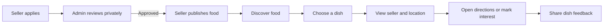
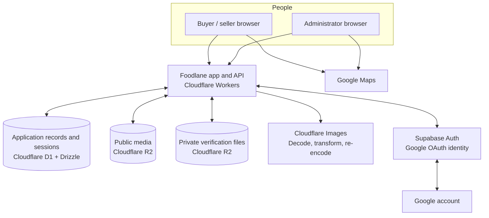

<div align="center">

# 🍽️ Foodlane

### Good food. Just around the corner.

Discover neighborhood dishes, meet the people who make them, and find your next local food stop.

<br />

[**Explore Foodlane ↗**](https://foodlane.nowshinaranini.workers.dev) · [GitHub repository](https://github.com/Nowshin-Ara-Nini/foodlane)

<br />

`Neighborhood discovery` · `Local cooks & sellers` · `Map-first browsing`

</div>

---

## ✨ About Foodlane

Foodlane brings local food discovery into one simple place. Buyers can explore dishes offered nearby, search by food or neighborhood, view public serving locations, and share feedback about a specific dish. Local cooks and sellers can introduce their food to the neighborhood after completing Foodlane’s seller review.

Foodlane is designed around a clear idea: **make it easier to discover local food and the people behind it.**

## 🧭 What you can do

| For buyers | For sellers | For administrators |
| --- | --- | --- |
| Browse available dishes and seller profiles. | Create a public seller profile. | Review seller verification submissions. |
| Search by dish, seller, neighborhood, city, or district. | Submit private identity and selling-place details for review. | Approve or reject seller applications. |
| Explore seller locations on maps and open directions. | Publish, update, or pause food listings after approval. | Moderate reports and suspend or delete accounts when needed. |
| Mark interest in individual dishes. | See customer interest and manage profile details. | Review sensitive submissions with fresh MFA and inspect audit history. |
| Leave a review for a dish or recommend a seller. | Share food with nearby customers. | Review recorded administrator actions. |

### How the experience works



> **A note on scope:** Foodlane helps people discover food. Marking interest is not an order. The service does not handle checkout, payments, or delivery. Seller verification reviews submitted identity and selling-place details; it is not a food-safety certification.

## 🏗️ Architecture



## 💡 Why this stack?

Foodlane uses a small set of managed services, each with a defined responsibility. This keeps the application focused on neighborhood discovery while avoiding a separately operated server and mail or database infrastructure.

| Choice | What it does | Why it fits Foodlane |
| --- | --- | --- |
| **Cloudflare Workers** | Runs the application and API. | The app already depends on Cloudflare’s runtime and storage products. Deploying them together keeps the runtime close to its database, files, image processing, and scheduled cleanup. |
| **Cloudflare D1** | Stores users’ Foodlane roles, profiles, dishes, feedback, moderation records, and server-side sessions. | D1 is a managed SQLite database that works directly with Workers. The relational data model is represented through explicit SQL and schema migrations rather than a separate database server. |
| **Drizzle ORM** | Defines database schemas and helps access D1. | It keeps table definitions and migrations in the repository, making schema changes reviewable and reproducible. |
| **Cloudflare R2** | Stores food and seller media separately from private verification evidence. | Object storage is a natural fit for uploaded photos and documents. Separate buckets let the application apply different access rules to public media and private evidence. |
| **Cloudflare Images** | Validates and transforms uploaded images before storage. | Re-encoding images helps remove metadata and creates a sanitized copy for use by Foodlane. The application still checks the actual visible contents of submitted images. |
| **Supabase Auth** | Handles Google OAuth identity verification. | OAuth is a specialized identity flow. Supabase handles the provider connection, while Foodlane retains its own roles, authorization rules, and server-side sessions in D1. Supabase is used for authentication here, not as Foodlane’s application database. |
| **Google Maps** | Displays locations and supports map interactions and directions. | It gives buyers a familiar way to understand where a seller serves and helps sellers select a location. Google Maps is an external service and may receive location, network, and browser information when loaded. |

### Why Cloudflare and Supabase together?

They solve different problems. **Cloudflare runs Foodlane and stores its application data and uploaded files. Supabase verifies a customer’s Google sign-in.** Foodlane then creates and checks its own application session and role. This separation keeps marketplace permissions under Foodlane’s control while delegating the Google OAuth exchange to an identity provider.

## 🧰 Technology

- **Application:** React, TypeScript, Vinext, Vite
- **Runtime and deployment:** Cloudflare Workers
- **Database:** Cloudflare D1, Drizzle ORM, versioned SQL migrations
- **Object and image storage:** Cloudflare R2 and Cloudflare Images
- **Identity:** Supabase Auth with Google OAuth
- **Maps:** Google Maps

## 🚀 Run locally

### Prerequisites

- Node.js **22.13+**
- pnpm **11.25**

Install dependencies from the lockfile:

```sh
pnpm install --frozen-lockfile
```

Create a local `.dev.vars` file for Worker bindings and credentials. This file is ignored by Git. Follow [SUPABASE_AUTH_RUNBOOK.md](SUPABASE_AUTH_RUNBOOK.md) for provider configuration; keep secrets in ignored local files or the hosting provider’s secret manager, never in source code or tracked documentation.

Initialize the local D1 database and private-storage setup:

```sh
pnpm db:migrate:local
node scripts/configure-private-local.mjs
```

Start the development server:

```sh
pnpm dev
```

Open the local URL printed by the server. The default is `http://localhost:5173`.

### Maps configuration

The app can display map embeds and open directions without a Maps JavaScript API key. Features that use the JavaScript API, such as interactive map controls, need a browser key configured as `VITE_GOOGLE_MAPS_API_KEY` in the ignored `.env.production.local` file.

Browser keys are visible to visitors by design. Restrict the key to the required Maps API and Foodlane’s approved HTTP referrers. Never use a private server credential as a browser key.

## 🗄️ Database workflow

SQL migrations are stored in [`drizzle/`](drizzle/). For a schema change:

1. Create a migration and review the SQL.
2. Apply it to the local database.
3. Run the relevant application checks.
4. Back up and verify the production D1 database before applying a production migration.

Apply reviewed migrations to the remote database with:

```sh
pnpm db:migrate:remote
```

For production database and recovery guidance, see [DEPLOYMENT_AUDIT.md](DEPLOYMENT_AUDIT.md) and [SECURITY_RUNBOOK.md](SECURITY_RUNBOOK.md). Do not run remote migrations against an unverified target.

## 🌐 Deploy to Cloudflare Workers

Foodlane currently targets Cloudflare Workers. Before deploying, make sure the production Worker has its required D1 and R2 bindings and secrets configured. Set the production authentication base URL and OAuth redirect allowlist to the deployed hostname. Keep secret **values** in Cloudflare Worker secrets or an ignored local production secrets file; do not put them in `wrangler.jsonc`, GitHub, or this README.

Build and deploy:

```sh
pnpm build
node --import ./scripts/sites-env.mjs ./node_modules/wrangler/bin/wrangler.js deploy --config dist/server/wrangler.json --secrets-file .env.production
```

After deployment, check the public pages, Google sign-in, seller and administrator access, food publishing, maps, and the listing/feedback flows. A successful build alone does not verify production credentials, remote migrations, or live authentication.

Foodlane currently uses a `workers.dev` hostname. To use a custom domain, you must control that domain, connect it to the Worker, and update the authentication provider’s allowed redirect URLs.

## 🔐 Privacy and security

Foodlane handles sensitive seller identity evidence, so access and retention are part of the product design:

- Verification evidence is stored in a private R2 bucket and is not served through public media routes.
- Authorized administrator review requires fresh MFA; views of sensitive review details and documents are audited.
- Once a seller verification is decided, the NID number and other verification-only fields are removed from the active D1 record. Private-file deletion is queued for the cleanup process.
- Public seller locations and images depend on seller approval and consent. Portrait publication is optional and separate from identity verification.
- Account suspension blocks Foodlane access. Account deletion removes Foodlane records and queues deletion with the identity provider where required.
- Application logs avoid NID values, private document contents, raw request bodies, and secret values.

These controls reduce exposure; they cannot prevent every risk, such as a compromised account or a sensitive detail visible in the content of a photo. Review the [Privacy Policy](app/privacy/page.tsx), [Terms](app/terms/page.tsx), and the [private-data](PRIVATE_DATA_RUNBOOK.md), [security](SECURITY_RUNBOOK.md), [admin account](ADMIN_ACCOUNTS_RUNBOOK.md), and [Supabase Auth](SUPABASE_AUTH_RUNBOOK.md) runbooks before handling real identity submissions.

## 🧪 Development checks

Run the relevant checks after a code change:

```sh
pnpm typecheck
pnpm lint
pnpm test
pnpm build
```

For the broader local release suite:

```sh
pnpm verify:release
```

The release suite does not apply remote migrations, configure production credentials, or prove that the deployed service is working.

## 🗂️ Repository map

```text
app/          Routes, pages, API handlers, and user-facing screens
components/   Shared interface components
db/           Database schema definitions
drizzle/      Versioned D1 migrations
lib/          Server-side application and domain logic
scripts/      Development, migration, and release helpers
tests/        Authentication, authorization, privacy, and feature tests
```


## 📄 License

Foodlane’s source code is released under the [MIT License](LICENSE). The license permits reuse, modification, and redistribution, including commercial use, provided the copyright and license notice are retained. Third-party dependencies and assets remain subject to their own licenses and terms.

## 🤝 Contributing

Contributions should preserve Foodlane’s privacy and role boundaries. Keep secrets and personal data out of commits, logs, screenshots, and fixtures. For changes to schemas, authentication, storage, or deployment, include the required migration and configuration notes. Run relevant checks and report any checks you could not complete.

---

<div align="center">

**Built for neighborhood food discovery.**

[Explore Foodlane](https://foodlane.nowshinaranini.workers.dev) · [View the source on GitHub](https://github.com/Nowshin-Ara-Nini/foodlane)

</div>
